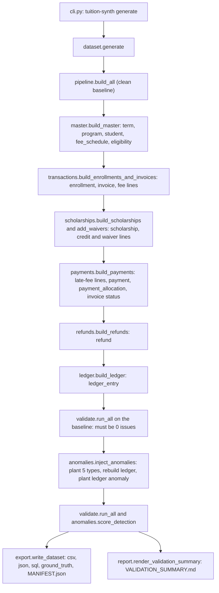

# Developer guide

Everything a developer needs to know to run, read, change and extend this project. Read it top to bottom once;
afterwards use the table of contents as a reference.

1. [What the project does](#1-what-the-project-does)
2. [Quick start and command reference](#2-quick-start-and-command-reference)
3. [Repository map](#3-repository-map)
4. [Architecture and data flow](#4-architecture-and-data-flow)
5. [Design principles](#5-design-principles)
6. [Module reference (file by file)](#6-module-reference-file-by-file)
7. [Business rules and constants](#7-business-rules-and-constants)
8. [The validator: every check](#8-the-validator-every-check)
9. [Output files](#9-output-files)
10. [Tests](#10-tests)
11. [How to extend the project](#11-how-to-extend-the-project)
12. [Troubleshooting](#12-troubleshooting)
13. [Glossary](#13-glossary)

Companion documents: [`../README.md`](../README.md) (overview and results), [`../DESIGN.md`](../DESIGN.md)
(business rules, lifecycles, anomaly plan, limitations), [`ER_DIAGRAM.md`](ER_DIAGRAM.md) (tables and
relationships), [`data_dictionary.md`](data_dictionary.md) (every field).

---

## 1. What the project does

It simulates the records of a university finance office for one year (three terms) and proves they are correct.

1. **Generate** a clean, internally consistent database: 10,000 students, 20 programs, fee schedules,
   30,000 invoices, 15,000 scholarship awards, 50,000 payments, refunds and a student ledger.
2. **Validate** it with an independent validator (must report 0 issues on the clean data).
3. **Plant** five kinds of labelled mistakes (the anomalies), recording each one in a separate `ground_truth` file.
4. **Score** the validator against the ground truth (did it find every planted mistake, and nothing else?).
5. **Export** CSV, JSON and SQL files with a manifest of checksums, and prove that two runs give identical bytes.

All data is synthetic and every run with the same seed (`20261022`) and scale produces identical files.

---

## 2. Quick start and command reference

```bash
python -m venv .venv && source .venv/bin/activate       # Windows: .venv\Scripts\activate
pip install -e ".[dev]"                                 # installs the package and pytest
pytest                                                  # 114 tests, about a minute
tuition-synth generate --scale 0.02 --formats csv,json,sql --out out/starter
```

Always run commands from the project root (the folder containing `pyproject.toml`).

### `tuition-synth generate`

Builds the dataset, validates it, injects and scores anomalies, writes the files.

| Option | Default | Meaning |
|---|---|---|
| `--seed N` | `20261022` | Seed for every random stream |
| `--scale X` | `1.0` | Volume multiplier. `1.0` = 10,000 students, `0.02` = 200 students. Programs stay at 20 |
| `--formats a,b` | `csv` | Any of `csv`, `json`, `sql` |
| `--gzip` | off | Write CSV files as `.csv.gz` |
| `--no-anomalies` | off | Skip anomaly injection (clean baseline only; no ground truth is written) |
| `--out DIR` | `out` | Output folder |

Prints row counts per table, the baseline validation result and the anomaly detection result. Exit code `0` means
the baseline is clean and every anomaly was found with no unexplained issue; `1` otherwise.

### `tuition-synth reproduce`

Runs `generate` twice into temporary folders and compares the row count and SHA-256 of every output file.
Takes the same run options as `generate` (except `--out`) plus `--report FILE` to save the result as Markdown.
Exit code `0` only if every file matches.

### `tuition-synth docs`

Rewrites `docs/data_dictionary.md` from `schema.py` (`--out FILE` to write elsewhere).

### Commands used for the committed data

```bash
tuition-synth generate --seed 20261022 --scale 0.02 --formats csv,json,sql --out data/starter
tuition-synth generate --seed 20261022 --scale 1.0  --formats csv --gzip   --out data/full
tuition-synth reproduce --scale 0.02 --formats csv,json,sql --report reports/reproducibility_starter.md
tuition-synth reproduce --scale 1.0  --formats csv           --report reports/reproducibility_full.md
```

---

## 3. Repository map

```
tuition-ledger-synth/
├── README.md                  overview, results, quick start
├── DESIGN.md                  assumptions, business rules, lifecycles, anomaly plan, limitations
├── AI_USAGE.md                how AI assistance was used in this project
├── LICENSE, pyproject.toml, .gitignore, .gitattributes
├── docs/
│   ├── DEVELOPER_GUIDE.md     this file
│   ├── ER_DIAGRAM.md          Mermaid ER diagram + relationship table + worked example
│   ├── data_dictionary.md     generated from schema.py (do not edit by hand)
│   └── PROMPT_LOG.md          the prompts used with the AI assistant
├── src/tuition_synth/         the package (section 6)
├── tests/                     114 tests (section 10)
├── data/
│   ├── starter/               scale 0.02: csv/, json/, sql/, ground_truth.*, MANIFEST.json, VALIDATION_SUMMARY.md
│   └── full/                  scale 1.0: csv/*.csv.gz, ground_truth.*, MANIFEST.json, VALIDATION_SUMMARY.md
└── reports/                   validation summaries and reproducibility reports (copies and results of the runs)
```

---

## 4. Architecture and data flow

### 4.1 The pipeline



`events.EventLog` is created in `pipeline.build_all` and passed to every stage that changes a status; at the end
`log.rows()` turns it into the numbered `status_event` table.

### 4.2 Step by step: what one `generate` run does

1. `cli.main` parses options and builds a `Config(seed, scale)`; `dataset.generate` takes over.
2. **Master data** (`master.build_master`): terms, programs, students, fee schedules, scholarship schemes.
3. **Enrollments and invoices** (`transactions.build_enrollments_and_invoices`): for each student and each term,
   draw one outcome (cancelled 1.5%, withdrawn 4%, otherwise completed), create the enrollment and its invoice with
   one line per fee from the price list valid on the issue date, and log the status events.
4. **Scholarships** (`scholarships.build_scholarships`): find each invoice's best eligible scheme, choose exactly
   15,000 awards at full scale, add a negative `SCHOLARSHIP_CREDIT` line to each invoice.
   **Waivers** (`scholarships.add_waivers`): waive one non-tuition fee on about 3% of invoices.
   Invoice totals are recomputed from their lines.
5. **Payments** (`payments.build_payments`): give each non-cancelled invoice a payment behaviour, add late-fee
   lines where money stays unpaid after the grace period, create installments (exactly 50,000 payments), number
   payments by date, allocate every payment to invoice lines, then replay each invoice's timeline to set its status
   and log status events. Some cancelled invoices were paid before cancellation.
6. **Refunds** (`refunds.build_refunds`): withdrawal refunds by tier, cancellation refunds, overpayment refunds,
   each with a REQUESTED / APPROVED / PAID (or REJECTED) path.
7. **Ledger** (`ledger.build_ledger`): one entry per line, payment, paid refund, plus a reversal per cancelled invoice.
8. **Validate the baseline** (`validate.run_all`). Any issue here is a generator bug and makes the run fail.
9. **Inject anomalies** (`anomalies.inject_anomalies`): four anomalies change the source tables; the ledger is
   rebuilt from them; the fifth anomaly alters one ledger entry; status events are renumbered.
10. **Validate again and score** (`validate.run_all`, `anomalies.score_detection`).
11. **Export** (`export.write_dataset`) and write `VALIDATION_SUMMARY.md` (`report.render_validation_summary`).

### 4.3 Dependency order between modules

`config` and `ids` and `schema` depend on nothing in the package. `master` uses them. `rules` uses `master.money` and
`schema`. Generators (`transactions`, `scholarships`, `payments`, `refunds`) use `master`, `rules`, `events`.
`ledger` uses `ids` and `schema`. `validate` uses `rules`, `ledger`, `schema`, `ids`, `master`. `anomalies` uses
`rules`, `ledger`, `events`. `pipeline` ties generators together; `dataset` adds validation, anomalies and export;
`cli` is the outermost layer.

---

## 5. Design principles

- **Derived, never independent.** Totals, net dues, statuses, refund amounts, ledger entries and balances are
  computed from source rows. Ground-truth labels come from documented rules, not random assignment.
- **One source of truth for structure.** `schema.py` defines tables, fields, enums, keys and lifecycles. The data
  dictionary, SQL DDL, CSV column order and the validator's structure checks are all generated from or driven by it.
- **Rules in one place.** `rules.py` holds the business rules as pure functions used by both the generators and the
  validator, so they cannot disagree.
- **The validator is independent of the generator's randomness.** It re-derives expectations from the tables only.
  It never receives `ground_truth` (a test checks its signature).
- **History is append-only.** Status changes are `status_event` rows; the ledger lists movements; late fees,
  credits and waivers are new invoice lines. Nothing is overwritten.
- **Reproducibility by construction.**
  - Each table has its own random stream: `random.Random(f"{seed}:{label}")` (`master.rng_for`). Changing one
    generator never shifts the numbers of another.
  - No wall-clock time: "today" is the fixed `AS_OF_DATE` (2026-12-31).
  - Money is `Decimal` rounded half-up to 2 places (`master.money`), never a float.
  - Outputs are sorted, UTF-8, LF line endings; gzip uses `mtime=0` and no file name.
  - IDs are deterministic, zero-padded counters.
- **Anomalies are isolated.** Each lands on a different student, only the labelled row changes, and a test proves
  the validator raises nothing on unlabelled rows.

---

## 6. Module reference (file by file)

All files are in `src/tuition_synth/`.

### `__init__.py`
Holds `__version__`. Nothing else.

### `config.py` — run configuration
- `Config(seed, scale, as_of)`: frozen dataclass. `Config.volume(name)` returns the row target for
  `students`, `scholarships`, `payments` (`max(1, round(base * scale))`); `programs` is fixed at 20. `invoices` is listed in
  `BASE_VOLUMES` for reference only: the invoice count is not drawn, it equals students x terms (one per enrollment).
  `scale <= 0` raises `ValueError`.
- `DEFAULT_SEED = 20261022`, `AS_OF_DATE = 2026-12-31`, `BASE_VOLUMES`, `TERMS` (Spring 12 Jan to 15 May,
  Summer 1 Jun to 31 Jul, Fall 17 Aug to 18 Dec, all 2026).
- Used by: every generator, `dataset`, `cli`.

### `ids.py` — ID conventions
- One builder per entity: `student_id(n)` gives `STU-000001`; `invoice_id(student, year, seq)` gives
  `INV-STU-000001-2026-000001`; `payment_id(year, n)` gives `PAY-2026-000001`; `allocation_id(payment, n)` gives
  `ALLOC-PAY-2026-000001-01`; plus `term_id`, `program_id` (`PRG-001`), `fee_schedule_id` (`FSC-00001`),
  `enrollment_id` (`ENR-000001`), `invoice_line_id` (`LINE-<invoice-id>-01`), `eligibility_id` (`ELG-001`),
  `scholarship_id` (`SCH-2026-000001`), `refund_id` (`REF-2026-000001`), `ledger_entry_id` (`LED-00000001`),
  `status_event_id` (`EVT-00000001`).
- `PATTERNS` and `is_valid(kind, value)`: regular expression per entity; table names equal the `kind` strings.
- Invoice counter is per student per year, so a student's invoices are `...-000001` to `...-000003`
  (`...-000004` appears only as the injected duplicate).

### `schema.py` — the single source of truth
- `Field(name, type, required, allowed, unit, unique, rule, fk)` and `Table(name, entity, pk, description, fields,
  relationships, extension)`; `Table.field_names`, `Table.foreign_keys()`.
- 14 table objects (`TERM`, `PROGRAM`, ... `STATUS_EVENT`) collected in `TABLES` in dependency order (parents first).
- Enumerations (`INVOICE_STATUS`, `LINE_TYPES`, `REFUND_REASONS`, ...) and `LIFECYCLES`, the allowed status
  transitions per entity (`{from_status: (to_status, ...)}`, with `None` as the starting point).
- Types are `string`, `int`, `decimal`, `date`. `extension=True` marks `term`, `ledger_entry`, `status_event`
  (not in the problem statement's entity list).
- Used by: `docs`, `ddl`, `export`, `validate`, `report`, tests.

### `docs.py` — data dictionary renderer
`render_data_dictionary()` returns the Markdown for `docs/data_dictionary.md`. A test fails if the committed file is stale.

### `reference_data.py` — hand-written inputs
`PROGRAMS` (code, name, level, tuition per term, has-lab, popularity weight), `OTHER_FEES` (LAB 8,000, LIBRARY 1,500,
TECHNOLOGY 3,000, ACTIVITY 2,000), `TERM_FEE_FACTOR` (Spring 1.00, Summer 0.60, Fall 1.05), `SCHEDULE_LEAD_DAYS` (30),
`SCHEMES` (8 scholarship schemes), `FIRST_NAMES`, `LAST_NAMES` (fabricated). Change a number here and the data
changes; tests that encode the documented rules will tell you.

### `master.py` — master tables
- `rng_for(cfg, label)`: independent random stream per table. `money(value)`: exact half-up 2-place `Decimal`.
- `build_terms()`, `build_programs()`, `build_fee_schedules(programs, terms)` (one row per program, term, fee type;
  LAB only for lab programs), `build_eligibility(programs)`, `build_students(cfg, programs)`
  (program by popularity weight; CGPA normal(7.2, 1.0) clipped to 4-10; income band 30/50/20 LOW/MIDDLE/HIGH;
  admission dates before the first term; every student ACTIVE), `build_master(cfg)`.
- `INVOICE_DUE_DAYS = 30` (stored on `term.invoice_due_days`).

### `events.py` — status history
- `EventLog.add(entity_type, entity_id, from_status, to_status, event_date)` records a transition;
  `date_of(...)` looks up when an entity first reached a status; `rows()` sorts everything by date and numbers it
  `EVT-00000001...`.
- `renumber(rows)` re-sorts and renumbers existing event rows (used after anomaly injection added events).

### `rules.py` — business rules (pure functions)
`is_eligible(student, scheme, on)`, `award_amount(scheme, tuition)`, `grace_end(invoice)`, `late_fee_date(invoice)`,
`line_net_dues(lines)`, `refund_share(days)`; constants `LATE_FEE_AMOUNT` (500.00), `GRACE_DAYS` (15), `REFUND_TIERS`,
`INCOME_RANK`, `CHARGE_LINE_TYPES`. Shared by generators and validator. Boundary behaviour is tested in `tests/test_rules.py`.

### `transactions.py` — enrollments, invoices, fee lines
- `build_enrollments_and_invoices(cfg, master, log)` returns `(enrollments, invoices, lines)` and logs events.
  Per student and term: enrolled 15-45 days before the term; invoice issued 1-10 days before it, due 30 days later;
  outcome drawn once (`P_CANCEL = 0.015`, `P_WITHDRAW = 0.04`); withdrawal day drawn from `WITHDRAW_WINDOWS`
  (1-14, 15-30, 31-45, 46+ days) so every refund tier occurs; fee lines copied from the fee schedule effective on the
  issue date.
- `recompute_invoice_totals(invoices, lines)` sets each invoice total to the sum of its lines (called again by later stages).
- `build_core(cfg)` runs just master + enrollments + invoices; it exists so tests can exercise the early stage alone.

### `scholarships.py` — awards and waivers
- `build_scholarships(cfg, master, invoices, lines, log)`: decision date 1-14 days before invoice issue; best eligible
  scheme per invoice (ties go to the lowest `eligibility_id`); a random subset of exactly `volume("scholarships")`
  candidates is awarded (limited funding); each award appends a `SCHOLARSHIP_CREDIT` line and logs
  AWARDED then APPLIED.
- `add_waivers(cfg, invoices, lines)`: with probability `P_WAIVER = 0.03` waive one non-tuition fee line in full;
  the `WAIVER` line carries the waived fee's `fee_schedule_id`.

### `payments.py` — payments, allocations, late fees, statuses
`build_payments(cfg, invoices, lines, log)` returns `(payments, allocations)` and mutates `lines` and `invoices`.
1. Draw a behaviour per non-cancelled invoice (`BEHAVIOR_WEIGHTS`): FULL_ON_TIME 73%, FULL_LATE 10%, PARTIAL 8%,
   OVERPAID 5%, UNPAID 4%.
2. 35% of cancelled invoices (`P_CANCELLED_PAID`) get one full payment before the cancellation.
3. `_plan_counts` gives each paying invoice 1-4 installments (50/30/15/5%) and nudges random invoices up or down
   until the total is exactly `volume("payments")`.
4. UNPAID, PARTIAL and FULL_LATE invoices receive a fixed `LATE_FEE` line dated the day after the grace period.
5. `_split` divides each total into installments (multiples of 100 except the last); `_dates` places them
   (on time, or the last one 1-45 days after the grace period for FULL_LATE). A late payer's final installment includes the fee.
6. Payments are sorted by date and numbered, given a method (`METHOD_WEIGHTS`) and a reference.
7. Allocation: each payment fills its invoice's charge lines in line order, up to each line's net due
   (`rules.line_net_dues`); a late-fee line cannot be paid before it exists. Leftover is an overpayment (unallocated).
8. Each invoice's timeline (due date, late fee, payments) is replayed with `_status` to set the final status
   (PAID / PARTIALLY_PAID / OVERDUE) and to log every change.

### `refunds.py` — refunds
`build_refunds(cfg, master, enrollments, invoices, lines, payments, allocations, log)`:
- WITHDRAWAL: per payment that paid tuition, `tuition allocated x refund_share(days)`. After day 45 nothing is
  owed; 60% of those students still ask and the claim is REJECTED.
- CANCELLATION: the whole allocated amount of each payment on a cancelled invoice.
- OVERPAYMENT: the unallocated part of a payment, for 60% of overpayers.
- Path per refund (`PATHS`, 85/7/8): PAID, stuck at APPROVED, stuck at REQUESTED. Steps dated after the as-of date are dropped.
  Refunds are numbered by request date.

### `ledger.py` — student ledger
`build_ledger(tables)` derives the entries from the source tables: CHARGE / LATE_FEE / SCHOLARSHIP_CREDIT / WAIVER
per invoice line, PAYMENT per payment, REFUND per paid refund, REVERSAL per cancelled invoice. Sorted by
(date, source table, source id, type) and numbered. Positive amounts mean the student owes more. The validator calls
this same function to re-derive the expected ledger from the tables it is given.

### `pipeline.py` — orchestration of generation
`build_all(cfg)` runs the stages above and returns the clean baseline as a dict of table name to list of row dicts, in
`schema.TABLES` order. `build_dataset(cfg, anomalies=True)` adds anomaly injection and returns `(tables, ground_truth)`.

### `anomalies.py` — injection, ground truth, scoring
- `inject_anomalies(cfg, tables)` mutates `tables` in place and returns ground-truth rows. 20 per type at full scale
  (`ANOMALIES_PER_TYPE`, at least 3 at any scale); each on a student no other anomaly uses.
  - `ALLOCATION_EXCEEDS_PAYMENT`: raises the last allocation of the latest payment of a fully paid, fee-free invoice.
  - `SCHOLARSHIP_EXCEEDS_FEES`: raises an award above its term's tuition.
  - `DUPLICATE_INVOICE`: copies an invoice as counter `000004` with its fee lines, a late fee and status history.
  - `REFUND_EXCEEDS_NET_PAID`: adds a PAID OVERPAYMENT refund larger than the student's net paid.
  - `BALANCE_LEDGER_MISMATCH`: changes one PAYMENT or CHARGE ledger entry (done after the ledger is rebuilt).
- `ISSUE_CHECKS` maps each type to the (table, check name) that must fire; `DECISIONS` gives the expected decision.
- `score_detection(issues, truth)` returns recall per type and the list of unexplained issues (issues on rows that are
  neither labelled nor named in `related_ids`).
- Ground-truth columns: `anomaly_id, issue_type, table, row_id, student_id, related_ids, description, expected_decision`.

### `validate.py` — validator
`Issue(check, table, row_id, detail)` and nine check functions combined by `run_all(tables, as_of)`:
`check_structure`, `check_enrollments`, `check_invoices`, `check_scholarships`, `check_payments`,
`check_late_fees_and_status`, `check_refunds`, `check_ledger`, `check_lifecycle`. `expected_balances(tables)` computes
each student's balance directly from invoices, payments and refunds (a second derivation to compare with the ledger).
Every check name is listed in section 8. It takes only tables, never ground truth.

### `report.py` — validation summary
`FAMILIES` groups the check names into families (and a test requires every check to belong to exactly one);
`render_validation_summary(meta, tables, baseline_issues, issues, score)` returns the Markdown written as
`VALIDATION_SUMMARY.md`.

### `export.py` — files
`format_value`, `csv_bytes`, `json_bytes`, `sha256_of`, and `write_dataset(out, tables, truth, formats, gzip_csv, meta)`
which writes every requested format and returns the manifest (also saved as `MANIFEST.json`). CSV: schema column
order, empty string for null, ISO dates, plain decimals. JSON: integers stay numbers, other values are strings,
null stays null. gzip: `mtime=0`, no file name.

### `ddl.py` — SQL
`schema_sql()` builds `CREATE TABLE` statements from `schema.py` with primary keys, `NOT NULL`, `UNIQUE`, foreign keys
and `CHECK (... IN (...))` for enumerations; `seed_sql(tables)` writes `INSERT` statements in 500-row batches inside a
transaction with `PRAGMA foreign_keys = ON`. Written for SQLite (loaded in `tests/test_export.py`).

### `dataset.py` — generate, reproduce
- `generate(cfg, out, formats, gzip_csv, anomalies)` runs steps 2-11 of section 4.2 and returns a dict with the tables,
  ground truth, issues, score, manifest and an `ok` flag.
- `reproduce(cfg, formats, gzip_csv, anomalies)` generates twice in temporary folders and compares row counts and checksums;
  `render_reproducibility(cfg, rows)` formats the result as Markdown.

### `cli.py` — command line
`main(argv)` defines the `generate`, `reproduce` and `docs` subcommands (section 2). Installed as the `tuition-synth`
script by `pyproject.toml`; also runnable with `python -m tuition_synth.cli`.

---

## 7. Business rules and constants

| Rule | Value | Where |
|---|---|---|
| Currency, rounding | INR, 2 decimals, half-up | `master.money` |
| Terms | Spring, Summer, Fall 2026 | `config.TERMS` |
| Term price factor | 1.00 / 0.60 / 1.05 | `reference_data.TERM_FEE_FACTOR` |
| Invoice issued | 1-10 days before term start | `transactions.ISSUE_LEAD_DAYS` |
| Invoice due | 30 days after issue | `master.INVOICE_DUE_DAYS` |
| Enrollment | 15-45 days before term start | `transactions.ENROLL_LEAD_DAYS` |
| Cancelled / withdrawn share | 1.5% / 4% | `transactions.P_CANCEL`, `P_WITHDRAW` |
| Grace period, late fee | 15 days, fixed INR 500 once per invoice, from the day after the grace period | `rules.GRACE_DAYS`, `LATE_FEE_AMOUNT` |
| Refund tiers | day 1-14: 100%, 15-30: 50%, 31-45: 25%, later: 0% | `rules.REFUND_TIERS` |
| Scholarship eligibility | CGPA at least the minimum, income band at or below the maximum, program match if set, scheme dates inclusive, judged on the decision date | `rules.is_eligible` |
| Award | percent of tuition or fixed sum, capped by the scheme cap and by the tuition | `rules.award_amount` |
| Awards decided | 1-14 days before invoice issue | `scholarships.AWARD_LEAD_DAYS` |
| Waiver share | 3% of invoices | `scholarships.P_WAIVER` |
| Payment behaviours | 73 / 10 / 8 / 5 / 4 % (on time, late, partial, overpaid, unpaid) | `payments.BEHAVIOR_WEIGHTS` |
| Installments | 1-4 with weights 50/30/15/5 | `payments.INSTALLMENT_WEIGHTS` |
| Cancelled invoices paid first | 35% | `payments.P_CANCELLED_PAID` |
| Refund paths | PAID 85%, APPROVED 7%, REQUESTED 8% | `refunds.PATH_WEIGHTS` |
| Rejected late claims, overpayment refunds | 60%, 60% | `refunds.P_REJECTED_CLAIM`, `P_OVERPAY_REFUND` |
| Anomalies | 20 per type at full scale, at least 3 | `anomalies.ANOMALIES_PER_TYPE` |
| Invoice status | PAID if allocations cover the total; PARTIALLY_PAID if some but not all; OVERDUE if nothing paid and past due; ISSUED before the due date; CANCELLED | `payments._status`, `validate.check_late_fees_and_status` |
| Student balance | sum of non-cancelled invoice totals - payments + paid refunds = sum of ledger entries | `validate.expected_balances`, `ledger.build_ledger` |

---

## 8. The validator: every check

Each check name below appears as `Issue.check`. Family names match `VALIDATION_SUMMARY.md`.

**Primary-key uniqueness and ID format**: `pk_duplicate` (repeated primary key), `pk_format` (ID does not match its
pattern), `columns` (row columns differ from the schema).

**Foreign-key integrity and joins**: `fk_missing` (referenced row does not exist), `invoice_enrollment_mismatch`
(invoice student or term differs from its enrollment), `line_fee_schedule_missing` / `line_fee_type` /
`line_wrong_schedule` / `line_schedule_not_effective` (an invoice line does not match the price-list row it cites),
`allocation_student_mismatch` (payment and invoice belong to different students), `refund_student_mismatch`,
`refund_enrollment` (refund points at an enrollment in the wrong state or of another student).

**Required fields, types, enumerations**: `required`, `type`, `enum`.

**Date ordering**: `withdrawal_date`, `invoice_due_date`, `line_date`, `allocation_date`, `refund_dates`,
`ledger_sequence`, `ledger_date_or_student`.

**Arithmetic reconciliation**: `invoice_total_mismatch` (total differs from the sum of lines), `line_amount_mismatch`,
`line_sign` (charge not positive or credit not negative), `invoice_status`, `late_fee_missing`, `late_fee_unexpected`,
`late_fee_wrong` (amount or date), `withdrawal_refund_amount`, `cancellation_refund_amount`, `refund_overpayment_amount`,
`ledger_amount_mismatch`, `ledger_missing`, `ledger_extra`, `balance_ledger_mismatch` (student balance differs from the
ledger), `scholarship_credit_mismatch`, `scholarship_amount_mismatch`.

**Lifecycle**: `lifecycle_no_history`, `lifecycle_chain` (an event does not start from the previous status),
`lifecycle_transition` (illegal step), `lifecycle_state_mismatch` (row status differs from the last event),
`refund_processed_on`.

**Duplicates**: `duplicate_invoice` (second active invoice for an enrollment), `duplicate_enrollment`,
`duplicate_scholarship`, `late_fee_duplicate`, `ledger_duplicate`.

**Scholarship rules**: `scholarship_not_eligible`, `scholarship_exceeds_cap`, `scholarship_exceeds_fees`,
`scholarship_no_invoice`, `scholarship_credit_line` (not exactly one credit line), `scholarship_credit_wrong_invoice`,
`waiver_target`, `waiver_exceeds_fee`.

**Allocation and refund limits**: `allocation_exceeds_payment`, `allocation_exceeds_line`, `allocation_amount`,
`allocation_to_non_charge_line`, `refund_exceeds_net_paid`, `refund_exceeds_payment`, `refund_amount`,
`refund_rejected_but_eligible`, `payment_amount`.

---

## 9. Output files

A dataset folder (see `MANIFEST.json` for the exact list):

| Path | Contents |
|---|---|
| `csv/<table>.csv` or `.csv.gz` | One file per table; header row = schema field order |
| `json/<table>.json` | Same rows as a JSON array (only with `--formats json`) |
| `sql/schema.sql`, `sql/seed.sql` | DDL and INSERTs for SQLite (only with `--formats sql`) |
| `ground_truth.csv`, `ground_truth.json` | Injected anomalies (absent with `--no-anomalies`) |
| `MANIFEST.json` | project, version, generator command, seed, scale, as-of date, Python version, provenance, and per file: path, table, rows, SHA-256 of the uncompressed content, size on disk |
| `VALIDATION_SUMMARY.md` | Row counts, baseline result, family counts, detection table, every check that fired |

The 14 tables are described in [`ER_DIAGRAM.md`](ER_DIAGRAM.md) and [`data_dictionary.md`](data_dictionary.md).

---

## 10. Tests

Run `pytest` (about a minute; several files build the full 10,000-student dataset once at import time).

| File | Tests | What it proves |
|---|---:|---|
| `test_config.py` | 3 | Volumes at full and small scale; invalid scale rejected |
| `test_ids.py` | 4 | Documented ID examples, every builder matches its pattern, malformed IDs rejected |
| `test_schema.py` | 6 | Required entities exist, keys and foreign keys are consistent, data dictionary is up to date |
| `test_rules.py` | 9 | Eligibility, award cap, late-fee date and refund tier boundaries, net dues (no data needed) |
| `test_master.py` | 13 | Master tables: counts, keys, enums, FKs, documented price factors and hand-checked prices, realistic distributions, determinism, CSV reproducibility |
| `test_transactions.py` | 11 | Enrollments and invoices: counts, ID sequence, outcome mix, withdrawal timing covers all tiers, price list, totals, event numbering |
| `test_validate.py` | 16 | **Breaks the data on purpose** (duplicate invoice, wrong amount, broken key, illegal transition, ...) and checks the validator notices |
| `test_billing_flow.py` | 14 | Scholarships, waivers, payments, allocations, late fees and statuses; exact 15,000 and 50,000 targets |
| `test_refunds_ledger.py` | 12 | Refund amounts by reason, limits, lifecycle; ledger counts, signs, order, balances |
| `test_anomalies.py` | 11 | 20 of each type, isolated students, 100/100 detected, no collateral damage, ground truth not an input |
| `test_export.py` | 10 | Manifest checksums, JSON, SQL loads with foreign keys and constraints, gzip determinism, reproducibility, CLI |
| `test_docs_in_sync.py` | 5 | ER diagram matches the schema; every validator check is in one report family; Markdown links resolve |

Test design notes:
- Tests compare against **independent expectations** (documented factors, hand-computed prices, literal tiers),
  not constants imported from the code under test. An earlier version imported the price factors it was meant to
  check; changing a factor changed both sides and the test could not fail. It was rewritten.
- Mutation-style tests (`test_validate.py`) deep-copy a small clean dataset, damage one thing, and assert that a
  specific `Issue` appears.
- Temporary folders come from `tempfile`, so the tests need no pytest fixtures.

---

## 11. How to extend the project

**Add a field to a table**
1. Add a `Field` in `schema.py`. 2. Fill it in the generator that builds that table (the validator rejects rows whose
columns differ from the schema). 3. Run `tuition-synth docs`. 4. Update `docs/ER_DIAGRAM.md` if it is a key or a shown
attribute (`tests/test_docs_in_sync.py` fails otherwise). 5. Regenerate `data/` and the reports.

**Add a table**
1. Define it in `schema.py` and add it to `TABLES` after its parents. 2. Create the rows in a generator and add it to
`pipeline.build_all`. 3. Add checks to `validate.py` and list them in `report.FAMILIES`. 4. Add it to
`docs/ER_DIAGRAM.md` (relationships, entity block, group table). 5. Add tests. 6. Regenerate documentation and data.

**Change a business rule** (for example the late fee or a refund tier)
1. Change the constant or function in `rules.py` (or the generator constant). 2. Update `DESIGN.md` section 3 and
section 7 of this guide. 3. Update the literal expectations in the tests that guard it (for example `test_rules.py`).
4. Regenerate and recommit `data/` and `reports/`; check the validation summary still shows 0 baseline issues.

**Add a scholarship scheme**
Add a row to `reference_data.SCHEMES`. Check with `tuition-synth generate` that the scheme is used and that the
scholarship count still reaches the target; adjust thresholds if candidates fall short of 15,000.

**Add an anomaly type**
1. Add an entry to `anomalies.ISSUE_CHECKS` and `DECISIONS`. 2. Write the injection in `inject_anomalies`: choose
candidates on unused students, change only the labelled row (and its related rows), call `record(...)`. 3. Make sure
a validator check fires on the labelled row (add one if needed, then list it in `report.FAMILIES`). 4. Extend
`tests/test_anomalies.py`; it must still find `unexplained == []`.

**Add a validator check**
Add an `Issue("name", table, row_id)` in the relevant check function, list the name in exactly one family in
`report.FAMILIES`, add a mutation test in `tests/test_validate.py`, and add it to section 8 of this guide.

**Add an export format**
Add a writer in `export.write_dataset`, include it in `cli.ALL_FORMATS`, and extend `tests/test_export.py`. Keep bytes
deterministic (sorted rows, fixed line endings, no timestamps).

After any change: `pytest`, regenerate the committed data and reports with the commands in section 2, and commit
code and data together.

---

## 12. Troubleshooting

| Symptom | Cause and fix |
|---|---|
| `tuition-synth: error: argument command: invalid choice: 'master'` | The installed command points at an old copy of the project. From the current project root run `pip install -e ".[dev]"`. Check with `python -c "import tuition_synth; print(tuition_synth.__file__)"` |
| `tuition-synth: command not found` | The virtual environment is not active, or the package is not installed. Activate it and run `pip install -e ".[dev]"`; or use `python -m tuition_synth.cli ...` with `PYTHONPATH=src` |
| A test passes or fails inexplicably after editing a file twice within a second | Stale bytecode in `__pycache__` (the file's timestamp did not change enough). Delete `__pycache__` folders and rerun |
| `git push` rejected: histories differ | A `.git` folder from another copy of the project was pasted over yours. Remove it, `git init`, add the remote, `git fetch`, `git reset origin/main`, then commit and push normally. Never copy `.git` between copies |
| Checksums in `MANIFEST.json` do not match files after cloning on Windows | Git converted line endings. `.gitattributes` forces LF for text files; re-clone after pulling it |
| `generate` exits with code 1 | Read the printed summary. A non-zero baseline issue count is a generator bug; an anomaly recall below 100% or unexplained issues means an injection or a validator check changed |
| Tests are slow | Several files build the full dataset at import time (about 5-10 seconds each). This is deliberate: the volume targets are asserted at full scale |
| Different gzip bytes on another machine | The compressor version can change compressed bytes. Compare the manifest's `sha256` (of the uncompressed content), which is stable |

---

## 13. Glossary

- **PK / FK**: primary key (unique ID of a row) / foreign key (ID that must exist in another table).
- **Baseline**: the clean dataset before any anomaly is planted. It must validate with 0 issues.
- **Anomaly / ground truth**: a deliberately planted mistake / the separate file that lists every one of them.
- **Invoice line**: one charge (fee, late fee) or credit (scholarship, waiver) on an invoice. Charges are positive, credits negative.
- **Net due (of a line)**: the line amount after the scholarship credit or waiver that targets it; payments are allocated against it.
- **Allocation**: the part of a payment applied to one invoice line (bridge table between payments and lines).
- **Overpayment / credit on account**: money paid beyond what is owed; it stays unallocated and shows as a negative balance.
- **Grace period**: 15 days after the due date during which no late fee is charged.
- **Ledger**: the append-only list of a student's money movements; the balance owed is its sum.
- **As-of date**: the fixed "today" (2026-12-31) used for statuses and late fees so runs are reproducible.
- **Scale**: volume multiplier; `1.0` is the full dataset.
- **Recall / unexplained issue**: share of planted anomalies the validator found / an issue raised on a row that was not planted.
