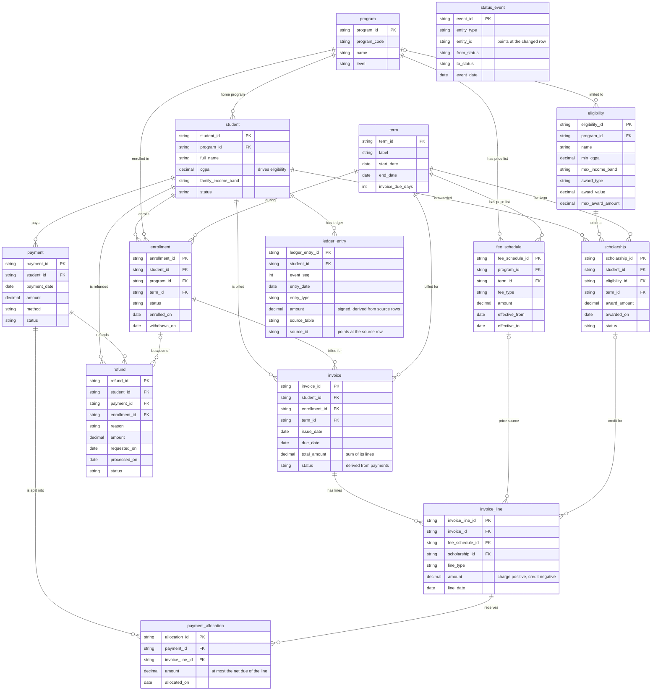

# Entity-relationship diagram

This page shows how the 14 tables of the dataset connect. It is meant for two readers: someone new to the
domain (what is an invoice line? why is there a bridge table?) and a developer who needs the exact keys.

The diagram below is plain text (Mermaid). GitHub draws it automatically; in VS Code install the
"Markdown Preview Mermaid Support" extension, or paste the code block into <https://mermaid.live>.
Only keys and the main attributes are drawn; every field with its type, allowed values and rule is in
[`data_dictionary.md`](data_dictionary.md). The relationships and keys below are checked against
`src/tuition_synth/schema.py` by `tests/test_docs_in_sync.py`, so they cannot silently drift.

## Diagram

## How to read it

- A box is a table. `PK` marks the primary key (the unique ID of a row); `FK` marks a foreign key (an ID that
  must exist in another table, which is how rows are connected).
- `||--o{` reads "exactly one on the left, zero or many on the right": one student has zero or many invoices.
- `|o--o{` means the parent is **optional**: an `invoice_line` may have no `fee_schedule_id`
  (late fees and credits are not priced from the price list).
- Money columns are decimals in INR. Dates are ISO dates (`YYYY-MM-DD`).

## The 14 tables in five groups

| Group | Tables | In plain words |
|---|---|---|
| Reference data | `term`, `program`, `fee_schedule`, `eligibility` | What can be charged and who can get a scholarship. |
| People and enrollment | `student`, `enrollment` | Who studies what, and when. |
| Billing | `invoice`, `invoice_line`, `scholarship` | What each student owes, line by line, including discounts. |
| Money in and out | `payment`, `payment_allocation`, `refund` | What was paid, how it was applied, and what was returned. |
| Audit trail | `ledger_entry`, `status_event` | Derived and append-only records; nothing is ever overwritten. |

Tables marked as extensions in the data dictionary (`term`, `ledger_entry`, `status_event`) are additions
beyond the 11 entities listed in the problem statement.

## Relationships

| Parent | Child | Foreign key in child | Cardinality | Meaning |
|---|---|---|---|---|
| `program` | `student` | `program_id` | 1 : 0..N | Each student has one home program. |
| `program` | `fee_schedule` | `program_id` | 1 : 0..N | Prices are set per program. |
| `term` | `fee_schedule` | `term_id` | 1 : 0..N | ...and per term (Summer is cheaper, Fall dearer). |
| `student` | `enrollment` | `student_id` | 1 : 0..N | A student enrolls once per term. |
| `program` | `enrollment` | `program_id` | 1 : 0..N | The program the student is enrolled in. |
| `term` | `enrollment` | `term_id` | 1 : 0..N | The term of the enrollment. |
| `program` | `eligibility` | `program_id` | 1 : 0..N (parent optional) | Optional: a scheme can be limited to one program (empty = all programs). |
| `student` | `invoice` | `student_id` | 1 : 0..N | All invoices of a student. |
| `enrollment` | `invoice` | `enrollment_id` | 1 : 0..N | Exactly one invoice per enrollment (a second active invoice is the DUPLICATE_INVOICE anomaly). |
| `term` | `invoice` | `term_id` | 1 : 0..N | The term being billed. |
| `student` | `scholarship` | `student_id` | 1 : 0..N | Awards received (at most one per student and term). |
| `eligibility` | `scholarship` | `eligibility_id` | 1 : 0..N | The scheme that granted the award. |
| `term` | `scholarship` | `term_id` | 1 : 0..N | The term the award applies to. |
| `invoice` | `invoice_line` | `invoice_id` | 1 : 0..N | An invoice is made of lines; its total is their sum. |
| `fee_schedule` | `invoice_line` | `fee_schedule_id` | 1 : 0..N (parent optional) | Optional: fee lines and waivers point at the price-list row they come from. |
| `scholarship` | `invoice_line` | `scholarship_id` | 1 : 0..N (parent optional) | Optional: a SCHOLARSHIP_CREDIT line points at its award. |
| `student` | `payment` | `student_id` | 1 : 0..N | Money received from a student. |
| `payment` | `payment_allocation` | `payment_id` | 1 : 0..N | One payment can be split across several lines. |
| `invoice_line` | `payment_allocation` | `invoice_line_id` | 1 : 0..N | One line can be paid by several payments. With the row above this makes Payment and InvoiceLine many-to-many. |
| `student` | `refund` | `student_id` | 1 : 0..N | Money returned to a student. |
| `payment` | `refund` | `payment_id` | 1 : 0..N | The payment being refunded. A payment can have more than one refund (for example a withdrawal refund and an overpayment refund). |
| `enrollment` | `refund` | `enrollment_id` | 1 : 0..N (parent optional) | Optional: set for withdrawal and cancellation refunds. |
| `student` | `ledger_entry` | `student_id` | 1 : 0..N | Every money movement of a student, in order. |

## What a box-and-line diagram cannot show

- **A many-to-many relationship through a bridge.** `payment` and `invoice_line` are many-to-many: one payment can
  pay several lines and one line can be paid by several payments (installments). `payment_allocation` is the
  bridge table; each row says "this much of this payment went to this line".
- **Polymorphic references.** `status_event.entity_id` and `ledger_entry.source_id` point at a row in the table
  named by `entity_type` / `source_table`. A single database foreign key cannot express that, so the validator
  checks these references in code.
- **Derived values.** These are calculated from other rows and never typed in:
  `invoice.total_amount` = sum of its lines; `invoice.status` follows payments and dates;
  a student's balance = sum of their `ledger_entry.amount`.
- **Net due of a line.** A `SCHOLARSHIP_CREDIT` line reduces the `TUITION` line; a `WAIVER` line reduces the fee line
  it points at through `fee_schedule_id`. Payments are allocated against these reduced amounts.
- **Append-only history.** State changes are new `status_event` rows; the ledger is a list of movements, not a
  running balance field.

## One real invoice, end to end

Invoice `INV-STU-000004-2026-000003` is in the committed starter data (`data/starter/csv`). It touches nearly
every table.

| Step | Table | Row (shortened) | What it shows |
|---|---|---|---|
| 1 | `student` | `STU-000004`, program `PRG-001`, CGPA 9.28, income band LOW | The person; the CGPA qualifies for the 50% scheme |
| 2 | `enrollment` | `ENR-000012`, `TERM-2026-FALL`, COMPLETED | The student studies in the Fall term |
| 3 | `invoice` | `INV-STU-000004-2026-000003`, issued 10 Aug, due 9 Sep, total 62,975.00, PAID | The bill for that enrollment |
| 4 | `invoice_line` (fees) | TUITION 94,500 + LAB 8,400 + LIBRARY 1,575 + TECHNOLOGY 3,150 + ACTIVITY 2,100 | Copied from `fee_schedule` rows `FSC-00011` to `FSC-00015` |
| 5 | `scholarship` | `SCH-2026-000007`, scheme `ELG-001` (Merit Gold), 47,250.00 | 50% of the tuition, within the scheme cap |
| 6 | `invoice_line` (credit) | SCHOLARSHIP_CREDIT -47,250.00 pointing at `SCH-2026-000007` | The award as a negative line |
| 7 | `payment` + `payment_allocation` | `PAY-2026-000709`: 3,000 on 15 Aug, all to the tuition line | First installment |
| 8 | `invoice_line` (late fee) | LATE_FEE 500.00 dated 25 Sep | Money was still owed after the grace period (9 Sep + 15 days = 24 Sep) |
| 9 | `payment` + `payment_allocation` | `PAY-2026-000988`: 59,975 on 26 Sep, split across six lines | Final installment: remaining tuition 44,250 + other fees 15,225 + the 500 late fee |
| 10 | `status_event` | ISSUED -> PARTIALLY_PAID (15 Aug) -> PAID (26 Sep) | The invoice history |
| 11 | `ledger_entry` | five CHARGE entries, one SCHOLARSHIP_CREDIT, two PAYMENT entries, one LATE_FEE | The student's money movements |

Check by hand: 94,500 + 8,400 + 1,575 + 3,150 + 2,100 - 47,250 + 500 = **62,975**, which equals both the invoice
total and the two payments (3,000 + 59,975).

## Where to read more

- [`data_dictionary.md`](data_dictionary.md): every field of every table.
- [`../DESIGN.md`](../DESIGN.md): the business rules and lifecycles behind these tables.
- [`DEVELOPER_GUIDE.md`](DEVELOPER_GUIDE.md): which source file creates which table.
